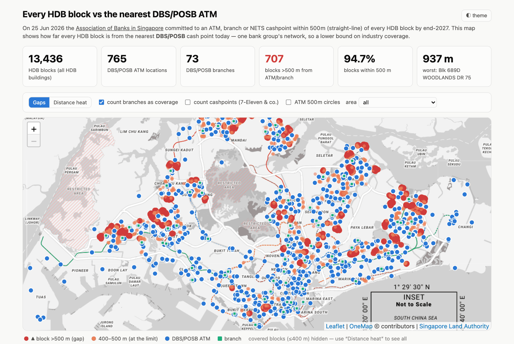
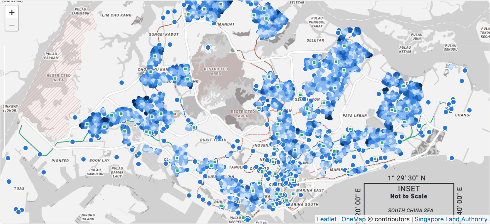
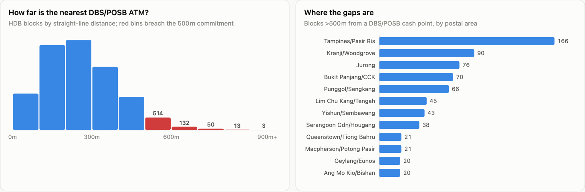

<div align="center">

# 🏧 Every HDB block vs the nearest DBS/POSB ATM

### Will every block have cash within 500 m by 2027?

On 25 June 2026 Singapore's banks promised an ATM, branch or NETS cashpoint<br>
within 500 m of every HDB block by end-2027. This map measures how far there is to go.

<br>

[](https://fang89.github.io/atm-500m/)

**👉 [fang89.github.io/atm-500m/](https://fang89.github.io/atm-500m/)**

<br>


<br>

<a href="https://fang89.github.io/atm-500m/"><picture><source media="(prefers-color-scheme: dark)" srcset="docs/screenshots/hero-dark.png"></picture></a>

</div>

---

## 📊 Headline findings

| | | |
|:-:|---|---|
| 🏢 | **13,436** HDB buildings | against **765** DBS/POSB ATM locations and **73** branches |
| ✅ | **94.7%** of blocks | are within 500 m of a DBS/POSB cash point |
| 🔴 | **707** blocks | are more than 500 m away |
| 📏 | **937 m** | the worst case: Blk 689D Woodlands Dr 75 |
| 📍 | **Biggest gap clusters** | Tampines/Pasir Ris (166), Kranji/Woodgrove (90), Jurong (76), Bukit Panjang/CCK (70), Punggol/Sengkang (66) |

> [!IMPORTANT]
> **This is a lower bound.** The ABS commitment is industry-wide (DBS + OCBC + UOB + NETS
> cashpoints). This project maps only the DBS/POSB network, so a "gap" block here may already
> be served by another bank or a NETS cashpoint. Distances are straight-line, as the ABS
> release itself defines them.

## 🗺️ Two ways to look

**Gaps** (above) hides every covered block and leaves only the ones at or past the limit.
**Distance heat** colours all 13,436 blocks by how far they are from cash.

<p align="center"><a href="https://fang89.github.io/atm-500m/"><picture><source media="(prefers-color-scheme: dark)" srcset="docs/screenshots/heat-dark.png"></picture></a></p>

Toggles let you count branches as coverage, add NETS cash-back merchants (7-Eleven,
Giant, Cold Storage, Guardian…), draw 500 m circles round every ATM, or zoom to one area.

## 📈 Where the gaps are

<p align="center"><a href="https://fang89.github.io/atm-500m/"><picture><source media="(prefers-color-scheme: dark)" srcset="docs/screenshots/charts-dark.png"></picture></a></p>

A table of the 50 worst-served blocks sits under the charts.

**Full methodology, definitions and limitations: [METHODOLOGY.md](METHODOLOGY.md)**

---

## 🛠️ For contributors

### Repo layout

```
scripts/fetch_dbs_atms.py     # DBS locator content-API capture (needs Playwright)
scripts/fetch_hdb_blocks.py   # HDB property info + OneMap geocoding (optional enrichment)
scripts/analyze.py            # nearest-ATM distance per block -> docs/data/*.json
data/                         # raw inputs (HDB Existing Building geojson, DBS capture)
docs/                         # the static dashboard (publish this folder)
docs/screenshots/             # images used in this README
```

### Refresh the data

```bash
python3 scripts/fetch_dbs_atms.py     # ~1 min, real browser via Playwright
# HDB Existing Building geojson: download from data.gov.sg into data/ (see link below)
python3 scripts/fetch_hdb_blocks.py   # optional, slow (OneMap rate limits): street/town enrichment
python3 scripts/analyze.py            # rebuilds docs/data/{blocks,atms,summary}.json
```

### Run locally

```bash
cd docs && python3 -m http.server 8000   # then open http://localhost:8000
```

### Deploy (free)

**GitHub Pages** (simplest): push this repo to GitHub → repo Settings → Pages →
"Deploy from a branch" → branch `main`, folder `/docs`. The dashboard is plain
static HTML + JSON, no build step.

Alternatives: Cloudflare Pages, Netlify, Vercel (all free for static sites) —
point them at the repo, set the output directory to `docs/`.

## 📚 Sources & licences

- [ABS media release, 25 Jun 2026](https://abs.org.sg/docs/library/singapore-banks-come-together-to-help-seniors-plan-well-age-well-and-ease-the-burden-on-their-loved-ones.pdf)
- [HDB Existing Building](https://data.gov.sg/datasets/d_16b157c52ed637edd6ba1232e026258d/view) and
  [HDB Property Information](https://data.gov.sg/datasets/d_17f5382f26140b1fdae0ba2ef6239d2f/view)
  — data.gov.sg, [Singapore Open Data Licence](https://data.gov.sg/open-data-licence)
- ATM/branch locations: DBS public branch-locator API (© DBS Bank; used here for
  research/commentary with attribution — not affiliated with or endorsed by DBS)
- Geocoding: [OneMap](https://www.onemap.gov.sg/), Singapore Land Authority
- Basemap: © OneMap, Singapore Land Authority
